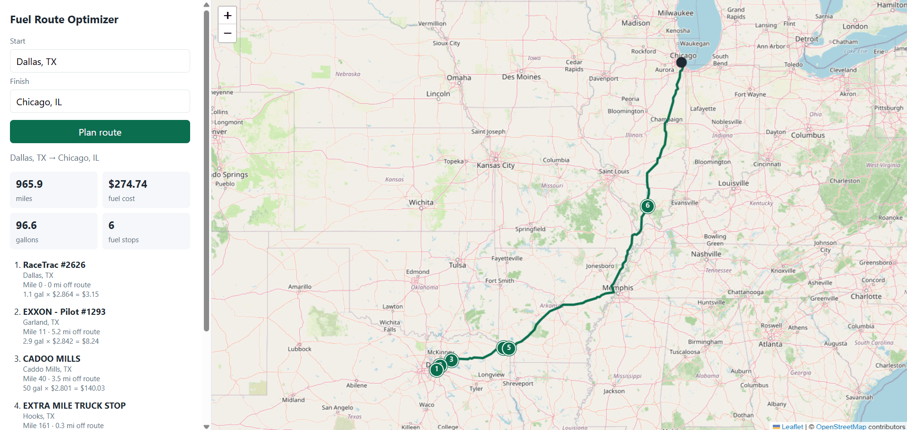
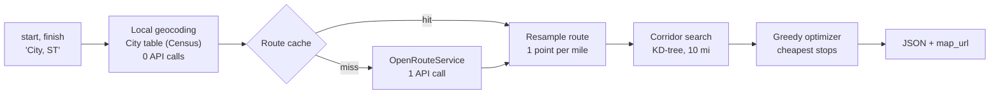

# Fuel Route Optimizer

A Django REST API that plans a truck route between two US cities, finds the **cheapest places to refuel** along it, and returns the total fuel cost. It assumes a 500-mile range and 10 miles per gallon.

Each request makes **one** external API call (OpenRouteService routing). Repeated trips make **none**.



---

## Contents
- [Quick start](#quick-start)
- [API](#api)
- [How it works](#how-it-works)
- [The fuel-stop algorithm](#the-fuel-stop-algorithm)
- [Data preparation](#data-preparation)
- [Performance](#performance)
- [Assumptions](#assumptions)
- [Out of scope and known limitations](#out-of-scope-and-known-limitations)
- [Configuration](#configuration)
- [Project structure](#project-structure)
- [Development](#development)
- [Data sources and credits](#data-sources-and-credits)

---

## Quick start

Both options need a free **OpenRouteService API key**. To get one, sign up at [openrouteservice.org](https://openrouteservice.org/dev/#/signup), then go to Dashboard and choose Request a token (Standard).

### Option A: Docker (recommended)

You need [Docker Desktop](https://www.docker.com/products/docker-desktop/) or Docker Engine with Compose v2.

```bash
git clone https://github.com/GloriousPurposeVariant/fuel-route-optimizer.git
cd fuel-route-optimizer
cp .env.example .env                 # Windows: copy .env.example .env
```

Edit `.env` and set two values:
- `ORS_API_KEY`: your OpenRouteService key
- `DJANGO_SECRET_KEY`: any long random string. To generate one without installing Python:
  ```bash
  docker run --rm python:3.14-slim python -c "import secrets; print(secrets.token_urlsafe(50))"
  ```

Then start everything:
```bash
docker compose up --build
```

On the **first** start, this:
1. builds the app image;
2. starts Redis;
3. creates the database;
4. loads about 49,000 US places and the 6,621 US fuel stations (about 30 seconds);
5. starts gunicorn with 3 workers.

Later starts skip the data loading, because the database is kept in a Docker volume.

Then open:
- **Map:** http://localhost:8000/map/?start=Dallas, TX&finish=Chicago, IL
- **API:** http://localhost:8000/api/route/?start=Dallas, TX&finish=Chicago, IL

| Command | What it does |
|---|---|
| `docker compose ps` | Shows status; `web` becomes `healthy` when ready |
| `docker compose logs -f web` | Follows the app logs (request timings, route cache hits and misses) |
| `docker compose exec web python manage.py ensure_data --force` | Reloads cities and stations, e.g. after changing the CSV |
| `docker compose down` | Stops everything and keeps the data |
| `docker compose down -v` | Stops everything and deletes the data volume |

### Option B: Local Python

You need **Python 3.12+**.

```bash
git clone https://github.com/GloriousPurposeVariant/fuel-route-optimizer.git
cd fuel-route-optimizer
python -m venv .venv
source .venv/bin/activate            # Windows: .venv\Scripts\Activate.ps1
pip install -r requirements-dev.txt

cp .env.example .env                 # Windows: copy .env.example .env
# In .env, set DJANGO_SECRET_KEY and ORS_API_KEY. Generate a secret key with:
python -c "import secrets; print(secrets.token_urlsafe(50))"

python manage.py migrate
python manage.py load_cities         # about 49k US places from the Census Gazetteer
python manage.py load_stations       # cleans the CSV and loads the US stations
python manage.py runserver
```

Then open:
- **Map:** http://127.0.0.1:8000/map/?start=Dallas, TX&finish=Chicago, IL
- **API:** http://127.0.0.1:8000/api/route/?start=Dallas, TX&finish=Chicago, IL

---

## API

### `GET /api/route/`

| Parameter | Required | Format | Example |
|---|---|---|---|
| `start` | yes | `City, ST` | `Dallas, TX` |
| `finish` | yes | `City, ST` | `Chicago, IL` |

Spelling variants are accepted: `Saint Louis, MO`, `St. Louis, MO` and `st louis, mo` are all the same place.

**Response (abridged, from a real Dallas to Chicago request):**
```json
{
  "start":  {"query": "Dallas, TX",  "name": "Dallas, TX",  "lat": 32.793333, "lon": -96.766513},
  "finish": {"query": "Chicago, IL", "name": "Chicago, IL", "lat": 41.837045, "lon": -87.684939},
  "distance_miles": 965.9,
  "duration_hours": 21.55,
  "vehicle": {"range_miles": 500.0, "miles_per_gallon": 10.0},
  "summary": {
    "total_gallons": 96.592,
    "total_fuel_cost_usd": 274.74,
    "fuel_stop_count": 6,
    "stations_considered": 189
  },
  "map_url": "http://127.0.0.1:8000/map/?start=Dallas%2C+TX&finish=Chicago%2C+IL",
  "fuel_stops": [
    {
      "opis_id": 68213, "name": "CADOO MILLS", "address": "I-30/US-67, EXIT 87 & FM-1903",
      "city": "Caddo Mills", "state": "TX", "lat": 33.074543, "lon": -96.226924,
      "mile_marker": 40.0, "distance_from_route_miles": 3.5,
      "price_per_gallon": 2.801, "gallons": 50.0, "cost_usd": 140.03
    }
  ],
  "route_geometry": {"type": "LineString", "coordinates": [[-96.76651, 32.79333], ["..."]]}
}
```

- `mile_marker` is how far into the trip the stop is.
- `distance_from_route_miles` shows how far the station is from the route line (see [limitations](#out-of-scope-and-known-limitations)).
- `route_geometry` is GeoJSON in `[lon, lat]` order, resampled to one point per mile.
- `total_fuel_cost_usd` is exactly the sum of the stops' `cost_usd`.
- `duration_hours` uses OpenRouteService's truck profile (`driving-hgv`), so it is longer than a car would take.

**Response headers:**

| Header | Meaning |
|---|---|
| `X-Route-Cache` | `MISS` means OpenRouteService was called; `HIT` means the route came from cache |
| `Server-Timing` | Time per step in ms: `geocode`, `route`, `corridor`, `optimize`, `details` |
| `X-Response-Time-ms` | Total server time for the request |

### Errors
Every error has the same shape:
```json
{"error": {"code": "LOCATION_NOT_IN_USA", "message": "'Toronto, ON' is not in the USA. Use a US state code, e.g. 'Dallas, TX'."}}
```

| Code | HTTP | When |
|---|---|---|
| `MISSING_PARAMETER` | 400 | `start` or `finish` is missing or empty |
| `INVALID_LOCATION_FORMAT` | 400 | Not in `City, ST` form |
| `LOCATION_NOT_IN_USA` | 400 | State code isn't one of the 50 states or DC, e.g. `Toronto, ON` |
| `UNSUPPORTED_REGION` | 400 | Alaska (reachable only through Canada) or Hawaii (no road link) |
| `LOCATION_NOT_FOUND` | 400 | Unknown city |
| `NO_ROUTE` | 422 | OpenRouteService found no drivable route |
| `ROUTE_TOO_LONG` | 422 | The route exceeds OpenRouteService's distance limit |
| `FUEL_GAP` | 422 | Part of the route has no station within the vehicle's range |
| `RATE_LIMITED` | 429 | More than 30 requests per minute from one client |
| `ROUTING_UNAVAILABLE` | 503 | OpenRouteService is down, the key is missing, or the quota is used up |
| `INTERNAL_ERROR` | 500 | Unexpected error (logged on the server) |

Input errors are caught **before** any external call, so a bad request never uses routing quota.

### `GET /map/?start=…&finish=…`
An HTML page that calls `/api/route/` from the browser and draws the route and numbered fuel stops with Leaflet on OpenStreetMap tiles. `/` redirects here.

### `GET /api/health/`
Returns `{"status": "ok"}`. It isn't rate-limited, and Docker uses it as the container health check.

---

## How it works



1. **Geocode locally.** `start` and `finish` are looked up in a `City` table built from the US Census Gazetteer, so no geocoding API is called.
2. **Route.** One call to the OpenRouteService directions API, using the `driving-hgv` (truck) profile with `avoid_borders=all`, so routes never leave the US. Successful routes are cached for 24 hours.
3. **Resample** the route line to one point per mile, so each point's index is its mile marker.
4. **Corridor search.** Stations are kept in memory as 3D unit-sphere coordinates. A `scipy` `cKDTree` built on the route points finds every station within 10 miles in one vectorized query, and gives each one a mile marker.
5. **Optimize** with the greedy algorithm below.
6. **Respond** with the stops, totals, a GeoJSON route and a link to the map.

---

## The fuel-stop algorithm

Stations are processed in trip order. The tank holds 500 miles of fuel. At each station:

1. **If a cheaper station is within range,** buy only enough fuel to reach the **nearest** cheaper one.
2. **Otherwise, if the destination is within range,** buy only enough to finish.
3. **Otherwise,** fill the tank, because this is the cheapest fuel within reach, and drive to the cheapest station within range.

This is the classic fixed-route "gas station problem" (Khuller, Malekian and Mestre, *To Fill or Not to Fill*). The greedy rule gives the minimum cost when prices are linear, and it runs in under a millisecond.

**Example:** at mile 0 the price is $3.80, and there's a $3.10 station at mile 280. The optimizer buys only 28 gallons at $3.80, then fills up at $3.10. Filling up at the start would cost about $20 more.

If two stations along the route are more than 500 miles apart, there's no valid plan, and the API returns `FUEL_GAP` instead of guessing.

---

## Data preparation

The fuel price CSV has no coordinates, and it needs cleaning. This is done **once, offline**, by management commands, so requests never read the CSV.

| Step | Rows |
|---|---|
| Rows in the CSV | 8,151 |
| Dropped: not in the 50 states + DC (Canadian provinces) | 620 |
| Dropped: duplicate station IDs (the cheapest price is kept) | 905 |
| **Unique US stations** | **6,626** |
| **Loaded with coordinates** | **6,621** (99.9%) |

- **Allow-list, not block-list:** only the 50 state codes plus DC are kept, so any unexpected code is rejected automatically.
- **Geocoding:** each station is placed at its **city center**.
  - `load_cities` builds about 49,000 lookup keys from the Census Gazetteer (places and county subdivisions), read straight from the committed zip files.
  - Names are normalized so the CSV and Census spellings match: `Saint`/`St`, `Mount`/`Mt`, `Fort`/`Ft`, `Mc Graw`/`McGraw`, `S`/`South`, `Boise City`/`Boise`, `Nashville-Davidson`/`Nashville`.
- **Fallback:** 123 places missing from Census data (for example Breezewood PA, Irving NY, Ruther Glen VA) were geocoded **once** with Nominatim by `build_city_overrides`. It ran at 1 request per second with an identifying User-Agent, and county-level matches were rejected. The result is committed as `data/city_overrides.csv`.
- **Unmatched:** 5 stations in 3 places (Saint Johns FL, Pendleton KY, Lawrence MS) only exist in OpenStreetMap as counties, so they're skipped and reported. They're never guessed.

```bash
python manage.py load_cities           # Census places and county subdivisions -> City table
python manage.py load_stations         # CSV -> cleaned FuelStation table (idempotent)
python manage.py ensure_data           # both of the above, only if the tables are empty (used by Docker)
python manage.py build_city_overrides  # one-time; output is already committed
```

---

## Performance

Measured locally for Dallas, TX to Chicago, IL:

| Step | First call | Repeat (cached route) |
|---|---|---|
| Geocode (local) | 3 ms | 6 ms |
| Route (OpenRouteService) | 1,644 ms | 19 ms |
| Corridor search (KD-tree) | 4 ms | 7 ms |
| Optimizer | 0.2 ms | 0.3 ms |
| Station details and geometry | 9 ms | 11 ms |
| **Total** | **1,671 ms** | **47 ms** |

- About 98% of a cold request is the external routing call. Our own work takes about 25 ms.
- Routes are cached for 24 hours, keyed by resolved coordinates and profile. Only the route is cached, so new prices or vehicle settings take effect immediately.
- The station index is built when the server starts, not on the first request. In Docker, gunicorn's `--preload` builds it once and shares it with all workers.
- The route geometry is resampled to one point per mile, so a 966-mile response is about 22 KB.
- With `REDIS_URL` set (as in Docker), the route cache and rate-limit counters are shared across all gunicorn workers.

---

## Assumptions

- **Vehicle:** 500-mile range and 10 mpg. Both are configurable.
- **Tank:** starts empty. The first purchase also covers the miles from the origin to the first station, so total gallons always equal distance ÷ mpg. The truck arrives at the destination empty.
- **Prices:** the CSV's retail price, taking the lowest price when a station appears more than once. Prices don't change during the trip.
- **Stations:** placed at their city's center, and considered "on the route" within 10 miles.
- **Input:** US cities in `City, ST` form, in the contiguous US.

---

## Out of scope and known limitations

| Item | Why / what I would do in production |
|---|---|
| **Authentication** | Not requested in the brief. I'd add DRF token or JWT auth with per-user rate limits. Anonymous access is rate-limited at 30/min to protect the routing quota. |
| **Exact station locations** | The CSV has addresses like "I-35, EXIT 72", not coordinates, so stations are placed at city centers. Each stop reports `distance_from_route_miles`. In production I'd geocode each address once and store it. |
| **Detours** | Driving off the route to a station isn't added to the trip distance or cost. |
| **Very small stops** | The optimizer finds the mathematically cheapest plan, which can include stops that save only cents, e.g. buying 1.2 gal to save $0.09. Next step: a minimum-savings threshold per extra stop. |
| **Raw lat/lon input** | Not accepted, because a coordinate can't be reliably checked as "in the USA" without a boundary dataset. `City, ST` keeps the USA-only rule exact. |
| **Alaska and Hawaii** | Rejected with `UNSUPPORTED_REGION`: Alaska is only reachable by road through Canada, and Hawaii has no road link. |
| **Live prices** | Prices come from the provided CSV. A production version would refresh them on a schedule. |
| **Database** | SQLite is enough for read-only reference data. A multi-instance deployment would use PostgreSQL. |
| **Browser JS tests** | The map's HTML contract is tested, but the JavaScript isn't, since that would need Playwright or Selenium. |

---

## Configuration

All settings come from environment variables (see `.env.example`). In Docker, `docker-compose.yml` reads `.env` and overrides the Docker-specific values (`DJANGO_DEBUG=False`, `REDIS_URL`, `SQLITE_PATH`).

| Variable | Default | Purpose |
|---|---|---|
| `DJANGO_SECRET_KEY` | **required** | Django secret key. The app refuses to start without it |
| `DJANGO_DEBUG` | `False` | Debug mode |
| `DJANGO_ALLOWED_HOSTS` | `localhost,127.0.0.1` | Comma-separated hosts |
| `ORS_API_KEY` | (none) | OpenRouteService key; routing returns `ROUTING_UNAVAILABLE` without it |
| `ORS_PROFILE` | `driving-hgv` | ORS profile, e.g. `driving-car` |
| `CORRIDOR_RADIUS_MILES` | `10` | How far from the route a station can be |
| `VEHICLE_RANGE_MILES` | `500` | Tank range |
| `VEHICLE_MPG` | `10` | Fuel economy |
| `ROUTE_CACHE_SECONDS` | `86400` | Route cache lifetime |
| `REDIS_URL` | (none) | Use Redis for the cache and rate limits; otherwise local memory. Set automatically in Docker |
| `SQLITE_PATH` | `./db.sqlite3` | SQLite file location. Set to `/app/var/db.sqlite3` (a volume) in Docker |
| `GUNICORN_WORKERS` | `3` | Docker only: number of gunicorn worker processes |
| `LOG_LEVEL` | `INFO` | Log level (`WARNING` during tests) |
| `NOMINATIM_USER_AGENT` | project URL | Only used by `build_city_overrides` |

---

## Project structure

```
Dockerfile              App image: Python 3.14 slim, collectstatic, non-root user, gunicorn
docker-compose.yml      App + Redis, health checks, data volume
.dockerignore           Keeps .env, .venv and .git out of the image
config/                 Django project: settings, URLs, WSGI (startup warm-up)
  exceptions.py         One error format for the whole API
  middleware.py         Request timing (X-Response-Time-ms) and logging
stations/               Data: models, cleaning and geocoding
  constants.py          US state allow-list (50 + DC) and supported states
  normalize.py          City-name normalization shared by loading and lookups
  fuel_csv.py           CSV parsing, allow-list filtering, cheapest-price dedupe
  geocoding.py          City lookups with the override fallback
  management/commands/  load_cities, load_stations, ensure_data, build_city_overrides
routing/                Logic and API
  locations.py          "City, ST" -> coordinates (no network)
  ors.py                The single OpenRouteService call
  geo.py                Vectorized spherical math
  corridor.py           Route resampling and KD-tree corridor search
  optimizer.py          Greedy fuel-stop algorithm
  services.py           plan_trip(): the pipeline, route cache and timings
  serializers.py        Request validation and the response contract
  views.py              /api/route/, /api/health/, /map/
  templates/routing/    Leaflet map page
data/                   Fuel price CSV, Census Gazetteer zips, city overrides
```

---

## Development

```bash
pip install -r requirements-dev.txt
python manage.py test -v 2     # 52 tests; OpenRouteService is mocked, so no key is needed
ruff check .                   # lint
ruff format .                  # format
```

GitHub Actions runs on every pull request:
- `ruff check` and `ruff format --check`;
- Django system checks, a missing-migration check and the full test suite on Python 3.12 and 3.14;
- a Docker image build.

The project was built as a series of feature branches, each merged through a pull request. See the [pull request history](https://github.com/GloriousPurposeVariant/fuel-route-optimizer/pulls?q=is%3Apr+is%3Aclosed) for the reasoning behind each step.

---

## Data sources and credits

- **Fuel prices:** provided with the assessment (`data/fuel-prices-for-be-assessment.csv`).
- **City coordinates:** [US Census Bureau Gazetteer Files](https://www.census.gov/geographies/reference-files/time-series/geo/gazetteer-files.html), 2025. Public domain.
- **Geocoding fallback:** © [OpenStreetMap](https://www.openstreetmap.org/copyright) contributors (ODbL), via [Nominatim](https://nominatim.org/).
- **Routing:** [OpenRouteService](https://openrouteservice.org/) (HeiGIT), built on OpenStreetMap data.
- **Map:** [Leaflet](https://leafletjs.com/) and © OpenStreetMap contributors tiles.
